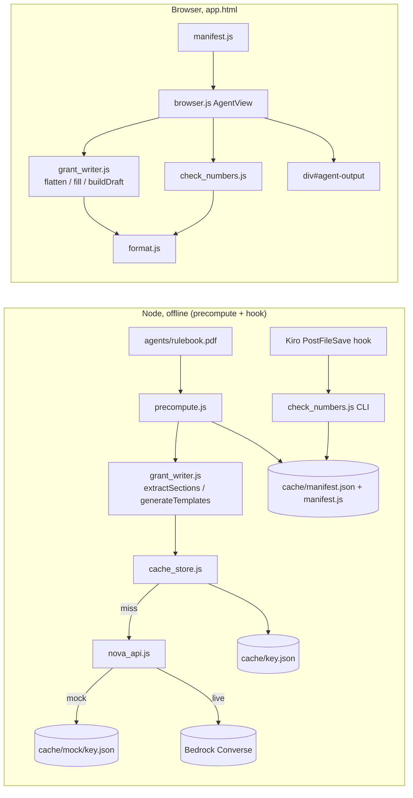

# Design Document: Grant Writer

## Overview

The Grant Writer turns `agents/rulebook.pdf` and one Record into an Application_Draft. Nova is used offline only: a Node precompute script asks Nova for the Section list and one digit-free Template per Section, validates each answer and caches it. The web page loads the cached Templates, and pure code (`flatten`, `fill`, `renderFixesTable`, `checkNumbers`) produces every number.

Stack findings (workspace inspection): no `package.json`, `calculator.js` and `app.html` are empty, Node is v24. `CLAUDE.md` says data is pasted inline into `app.html` and never fetched at runtime, so the page may run from `file://`. Two consequences:
- Shared modules are classic scripts with a small UMD wrapper (`module.exports` in Node, one global in the browser). ES modules are avoided because `<script type="module">` fails under `file://`.
- The browser reads the cache through a generated script, `agents/cache/manifest.js`, instead of `fetch`.

Integration points owned by Person B (to agree, not to edit): `app.html` needs the `<script>` tags listed under Architecture, a `<div id="agent-output">`, and a call to `AgentView.render(record)` when a greenhouse is selected. Ready-to-paste snippets for all three are in `agents/INTEGRATION.md`. `data/greenhouses_hampshire.json` does not yet match `data/record-shape.md` (no `fixes`, `estimate`, `evidence`), so tests use Person A fixtures in `agents/test/fixtures/`.

## Architecture



Script order for `app.html`: `agents/format.js`, `agents/check_numbers.js`, `agents/grant_writer.js`, `agents/cache/manifest.js`, `agents/browser.js`.

Design decisions:
- **Dependency injection for model calls.** `extractSections` and `generateTemplates` take a `deps` object (`readRulebook`, `ask`, `askWithPdf`). `grant_writer.js` therefore contains no `require` and loads in the browser. `precompute.js` wires the Node implementations.
- **Cache above the client.** `cache_store.cachedCall` checks the Cache, calls Nova on a miss, validates, and only then writes (Requirement 5.1, 5.4). `nova_api.js` only talks to Bedrock or the Mock_Directory.
- **Quote_Request is a code constant**, `QUOTE_REQUEST_TEMPLATE`, with Placeholders only (`{top_fix_name}`, `{sqft}`, `{covering}`, `{town}`). It is validated by `validateTemplate` in a unit test. No model call writes vendor text.
- **The browser re-checks before display.** `AgentView.render` runs `checkNumbers` on every Filled_Text and the Fixes_Table and shows an error instead of the draft on failure.

## Components and Interfaces

All files live in `agents/`. "UMD" means the file works as a Node module and as a classic browser script that sets one global.

### `format.js` (UMD, global `AgentFormat`)
- `formatNumber(n): string`. The single number formatter, used by `fill`, `renderFixesTable` and `checkNumbers`.
  - Throws on a non-finite number.
  - Takes the shortest round-trip decimal string of `|n|` (`String(n)`; exponent notation is expanded to plain digits), groups the integer part with commas every three digits (en-US), keeps the fraction digits as they are, and prefixes `-` for negatives. Examples: `2906 → "2,906"`, `3.5 → "3.5"`, `-72.532322 → "-72.532322"`, `40000 → "40,000"`.
  - No currency symbol, no unit, no padding. Templates write units in words (for example "{grant_request} dollars") or a `$` in prose.
  - Rounding is not done here. `flatten` stores rounded values, so the displayed value equals the stored value.
- `NUMBER_RE`: the token regex shared with `checkNumbers`: `/[$€£]?\d(?:[\d,]*\d)?(?:\.\d+)?%?/g`. It matches digits next to letters (no word boundary). A token cannot end in a comma, so a sentence comma after a number is not part of it.

### `nova_api.js` (Node, CommonJS)
- `askNova(prompt): Promise<string>`
- `askNovaWithPdf(prompt, pdfBytes: Uint8Array): Promise<string>`
- Constants: `REGION = "us-east-1"`, `MODEL_ID = "us.amazon.nova-2-lite-v1:0"`.
- Live mode (`AWS_BEARER_TOKEN_BEDROCK` set), deferred until the user says AWS access is ready: one `ConverseCommand` from `@aws-sdk/client-bedrock-runtime` per call, `inferenceConfig: { temperature: 0 }`. The PDF goes in a document block, `{ document: { format: "pdf", name: "rulebook", source: { bytes } } }`, next to the text block. Returns the concatenated text blocks of `output.message.content`. The rulebook is 1,898,292 bytes, under the Converse per-document size limit.
  - Verify when AWS access arrives: whether the installed SDK version picks up `AWS_BEARER_TOKEN_BEDROCK` automatically ([aws-sdk-js-v3 issue #7204](https://github.com/aws/aws-sdk-js-v3/issues/7204)). Fallback if it does not: `fetch` to `https://bedrock-runtime.us-east-1.amazonaws.com/model/<modelId>/converse` with header `Authorization: Bearer <token>`, as described in [Use an Amazon Bedrock API key](https://docs.aws.amazon.com/bedrock/latest/userguide/api-keys-use.html). The token is read from the environment only and never logged.
- Mock mode (variable unset): logs `MOCK MODE`, makes no network call, reads `agents/cache/mock/<key>.json` where `key = cacheKey(MODEL_ID, prompt, pdfBytes)`, and returns its `text` field. A missing file throws `Mock response missing: <absolute path>`. Mock mode is built and tested first.

### `cache_store.js` (Node, CommonJS)
- `cacheKey(modelId, prompt, pdfBytes|null): string` = hex `sha256(JSON.stringify([modelId, prompt, pdfBytes ? sha256hex(pdfBytes) : null]))`. The JSON array keeps the three inputs unambiguous; a text-only request and a request with an empty PDF get different keys.
- `cachedCall({ prompt, pdfBytes, call, validate }): Promise<string>`
  1. If `cache/<key>.json` exists: read it. An unreadable or zero-byte file throws naming the path (5.6). Otherwise return `text` unchanged, with zero Nova calls (5.2).
  2. Else `text = await call()`. A Nova error propagates and nothing is written (5.4).
  3. `validate(text)` throws on rejection, and nothing is written (5.4).
  4. Write `{ "text": text }` to `<key>.json.tmp`, then rename it to `<key>.json`. Creates `agents/cache/` if absent. On failure, delete the tmp file and throw naming the path (5.7).

### `grant_writer.js` (UMD, global `AgentGrantWriter`)
- Constants, each with a source comment: `GRANT_SHARE = 0.8`, `GRANT_CAP_USD = 50000` (both confirmed by the state's CSAP rulebook: minimum 20% cash match, Greenhouse Energy Efficiency maximum $50,000; source comment cites "CSAP FY26 RFR and Round II how-to page"), `CO2_KG_PER_GALLON = 5.72` (user-supplied propane factor).
- `PLACEHOLDER_NAMES`: `id, name, lat, lon, sqft, covering, town, utility, hdd, price_per_gal` plus the 11 Derived_Fields. `bays` is excluded.
- `QUOTE_REQUEST_TEMPLATE`: digit-free code constant (see Architecture).
- `async extractSections(deps): Section[]`
  - `deps.readRulebook()` returns the bytes of `agents/rulebook.pdf`. A missing or zero-byte file throws before any Nova call, naming the path and saying "missing" or "empty" (1.6).
  - One `cachedCall` with `deps.askWithPdf(EXTRACTION_PROMPT, bytes)`. The prompt asks for JSON `{"sections":[{"name":"...","criteria":["..."]}]}`.
  - `parseSections(text)` strips code fences, parses JSON, trims each name and criterion, and keeps response order. It throws `no sections extracted` on a parse failure or zero Sections, and names any empty or duplicated Section (1.8). It is also the `validate` callback.
- `async generateTemplates(sections, deps): {name, template}[]`. One `cachedCall` per Section, in Section-list order. The prompt contains the Section name, its criteria, the Placeholder list, and the instructions from 2.4 (fixes only through `top_fix_*`; missing programme names, cost-share percentages, deadlines and fuel prices as `{UNKNOWN: ...}`; no digits). `validate` is `validateTemplate`. The Template is the trimmed response text. Errors are rethrown with the Section name prefixed (1.7, 2.3).
- `validateTemplate(text): { ok, offending: string[] }`. Rejects, listing every offender:
  - empty or whitespace-only text;
  - each digit character `0`–`9`;
  - each `{...}` token that is neither a Placeholder nor an Unknown_Marker with a non-empty description (this covers `{bays}`, `{fixes}`, `{estimate.low}` and any dotted path);
  - each stray `{` or `}` outside a token;
  - two Placeholders separated by nothing or only by `,` or `.` characters (for example `{sqft}{hdd}` or `{sqft},{hdd}`). Their filled values would merge into one number token and fail `checkNumbers`.
- `flatten(record): FlatRecord` (pure). See Data Models.
- `fill(template, flat): string` (pure). Single pass over `/\{([^{}]*)\}/g`:
  - an Unknown_Marker is kept verbatim;
  - a Placeholder whose value is a number becomes `formatNumber(v)`, a string is inserted verbatim, a boolean becomes `"true"` or `"false"`;
  - any other token, or a Placeholder whose key is absent or holds `null`, `undefined`, an object or an array, is collected. If any were collected, `fill` throws once, naming all of them (3.8).
  - Text outside tokens is untouched. Inserted strings are not re-scanned.
- `renderFixesTable(record): string[][]`. A header row (`Fix`, `Saves (USD per year)`, `Cost (USD)`, `Payback (years)`), then one row per element of `record.fixes` in array order. Number cells use `formatNumber`; string cells are copied; any other value becomes `{UNKNOWN: <field>}`. **No totals row**: a computed total is not a Flat_Record value and would fail `checkNumbers`. `fixesTableText(rows)` joins cells with ` | ` and rows with `\n`, for checking.
- `buildDraft(record, manifest): Draft`. Throws naming `evidence.quote_uploaded` if it is not a boolean (2.9). It computes `flat = flatten(record)` and returns `{ quoteMissingLabel, sections: [{name, text: fill(template, flat)}], fixesTable, quoteRequest: fill(QUOTE_REQUEST_TEMPLATE, flat) }`. `quoteMissingLabel` is `"application draft: quote missing"` when `quote_uploaded` is false and `null` when it is true.

### `check_numbers.js` (UMD, global `AgentCheckNumbers`; CLI when run by Node)
- `checkNumbers(text, flat): { pass: boolean, rejected: string[] }`
  - Throws naming `text` or `flatRecord` if the argument type is wrong (4.6).
  - Allowed values: every finite number found at any depth of `flat` (objects and arrays included), stored as `|v|`; plus every token that `NUMBER_RE` finds in any string at any depth, parsed the same way.
  - For each token in `text`: strip `$€£`, `,` and `%`, then convert with `Number`. The token is accepted if the value is in the allowed set, or if it is an Allowed_Number. A year is exactly four bare digits from 1900 to 2099. A section number is a bare integer directly after the case-sensitive text `Section ` (one space).
  - A `-` before a token is prose, which is why values are compared as absolute values. Rejected tokens are returned exactly as written, once per occurrence, in order. The function never throws on rejection.
- CLI `node agents/check_numbers.js`: loads `agents/cache/manifest.json` and every available Record. Records come from `agents/test/fixtures/records.json`, plus the elements of arrays in `data/*.json` that have a `fixes` array and an `evidence` object. For each Record it checks each Section's `fill` output and `fixesTableText`, prints `PASS` or `<Section name | Fixes_Table>: <rejected numbers>`, and exits 0 or 1. A `fill` throw is reported as a failure for that Section.
- Kiro hook `.kiro/hooks/check-numbers.json`: trigger `PostFileSave`, matcher `agents[\\/]`, command `node agents/check_numbers.js` (4.9).

### `browser.js` (classic script, global `AgentView`)
- Module state `applicantChecks = { match_is_cash: false, nothing_bought: false }`. Not persisted, not in the Record.
- `getApplicantChecks()` returns a copy, for the Reviewer.
- `render(record)`: finds `#agent-output`; does nothing else if it is absent. It clears the div and renders, using `textContent` only:
  - the label line, if present;
  - one `<section>` per Section (`<h3>` name, `<p>` Filled_Text);
  - the Fixes_Table as a `<table>`;
  - the Quote_Request;
  - two checkboxes, "Match is cash" and "Nothing bought yet", whose `checked` state comes from `applicantChecks`.
  Each `change` handler only sets the matching boolean. If `buildDraft` or `checkNumbers` fails, it renders the error message instead of the draft.
- Reads `window.AGENT_CACHE` (from `manifest.js`) only. It makes no Nova call, no `fetch`, and no write to the Record or `data/`.

### `precompute.js` (Node, CLI)
`node agents/precompute.js` builds the Node deps (rulebook reader, `nova_api`), runs `extractSections` and then `generateTemplates`, and writes `manifest.json` and `manifest.js`. Any error exits 1 with the message, and no manifest is written. In mock mode, each missing mock file stops the run with its path. Template prompts depend on the extraction output, so mock files are added one run at a time.

## Data Models

```ts
type Section = { name: string; criteria: string[] };

// Flat_Record = Record fields copied unchanged (shallow) + Derived_Fields
type FlatRecord = Record & Partial<{
  estimate_low: number; estimate_high: number; estimate_point: number;
  top_fix_name: string; top_fix_saves_usd: number; top_fix_cost_usd: number;
  top_fix_payback_years: number;
  grant_request: number; farmer_match: number;
  gallons_saved: number; carbon_tons_saved: number;
}>;
```

`flatten` derivation (a field is omitted, never set to `null`, when its input is invalid):

| Field | Rule | Omitted when |
|---|---|---|
| `estimate_low/high/point` | `estimate.low/high/point` | `estimate` absent; each field individually when its source is `undefined` |
| `top_fix_*` | Top_Fix = first index with max `saves_usd` | `fixes` absent or empty, or any element has a non-finite `saves_usd` or `cost_usd` (conservative choice: crash rather than pick from bad data) |
| `grant_request` | `Math.round(Math.min(GRANT_SHARE * cost, GRANT_CAP_USD))` | as `top_fix_*` |
| `farmer_match` | `Math.round(cost) - grant_request` (equal to round(cost − grant_request) because `grant_request` is an integer; avoids float drift) | as `top_fix_*` |
| `gallons_saved` | `Math.round(top_fix_saves_usd / price_per_gal)` | as `top_fix_*`, or `price_per_gal` not a number > 0 |
| `carbon_tons_saved` | `Math.round(gallons_saved * CO2_KG_PER_GALLON / 1000 * 10) / 10` | as `gallons_saved` |

Cache layout:

```
agents/cache/
  <sha256>.json      { "text": "<full Nova response>" }   one per validated request
  mock/<sha256>.json { "text": "<hand-written response>" } Mock_Mode inputs
  manifest.json      { "model_id", "rulebook_sha256", "sections": [ { "name", "criteria", "template" } ] }
  manifest.js        window.AGENT_CACHE = <manifest.json contents>;
```

`manifest.json` and `manifest.js` let the browser and the hook find outputs without recomputing hashes. Both are written last, only after a full successful run (5.5).

## Correctness Properties

*A property is a characteristic or behavior that should hold true across all valid executions of a system-essentially, a formal statement about what the system should do. Properties serve as the bridge between human-readable specifications and machine-verifiable correctness guarantees.*

Reflection: the formula criteria (3.2–3.5) are merged into one model-based property. 4.1 and 4.2 are covered by the formatter round trip, the rejection property and the fill/check round trip. 2.7 and 2.8 are merged into one equivalence.

### Property 1: Top_Fix and grant split

*For any* Record with a non-empty `fixes` array of finite numbers, `flatten(record).top_fix_saves_usd` equals the maximum `saves_usd`, the Top_Fix is the earliest element with that value, `grant_request ≤ GRANT_CAP_USD`, and `grant_request + farmer_match === Math.round(top_fix_cost_usd)`.

**Validates: Requirements 3.3, 3.6**

### Property 2: flatten matches the derivation table

*For any* Record (with valid or invalid `fixes`, `price_per_gal` and `estimate`), every Derived_Field in `flatten(record)` is present and equal to the reference formula when its inputs are valid, and absent when they are invalid. All Record fields are copied unchanged.

**Validates: Requirements 3.2, 3.3, 3.4, 3.5**

### Property 3: Number formatting round trip

*For any* finite number `n`, `formatNumber(n)` matches `NUMBER_RE` (after an optional leading `-`) as exactly one token, and that token parses back to `Math.abs(n)`.

**Validates: Requirements 3.10, 4.1**

### Property 4: fill completeness

*For any* Template accepted by `validateTemplate` and any Flat_Record holding a number, string or boolean at every referenced Placeholder (string values without braces), `fill` returns text with zero Placeholders, and each Placeholder position holds the formatted value of its key.

**Validates: Requirements 3.7, 3.11**

### Property 5: Unknown_Markers and prose preserved

*For any* accepted Template and matching Flat_Record, removing the filled values from `fill(template, flat)` leaves the Template's prose segments and Unknown_Markers exactly as written, in order, including whitespace and line breaks.

**Validates: Requirements 3.9**

### Property 6: fill rejects bad tokens

*For any* Template containing one or more bad tokens (non-Placeholder names such as `{bays}`, dotted paths, `fixes`/`estimate`/`evidence`, or Placeholders whose key is missing, `null`, an object or an array), `fill` throws an error whose message names every bad token.

**Validates: Requirements 3.5, 3.8**

### Property 7: flatten and fill are pure

*For any* Record and Template, calling `flatten` and `fill` twice gives deep-equal results, and the Record, Flat_Record and Template are deep-equal to snapshots taken before the calls.

**Validates: Requirements 3.12**

### Property 8: Template validation

*For any* Template built from prose without digits, Placeholders, and Unknown_Markers, `validateTemplate` accepts it. *For any* such Template with injected digits, `{bays}`, dotted or object-name tokens, empty Unknown_Markers, stray braces, or adjacent Placeholders, it rejects the Template and lists every injected offender.

**Validates: Requirements 2.2, 2.3**

### Property 9: Fill then check round trip

*For any* accepted Template and any Record whose Flat_Record covers every referenced Placeholder (including string fields containing digits and `fixes` of any length), `checkNumbers(fill(t, flatten(r)), flatten(r)).pass` is `true`.

**Validates: Requirements 4.2, 4.7**

### Property 10: Fixes_Table is copied and checks clean

*For any* Record, `renderFixesTable(record)` has one header row plus one row per element of `fixes`, in order, each cell equal to the formatted or copied element value. `checkNumbers(fixesTableText(rows), flatten(record)).pass` is `true`.

**Validates: Requirements 2.6, 4.8**

### Property 11: Foreign numbers are rejected in order

*For any* digit-free prose and any list of numbers that are neither Flat_Record values nor Allowed_Numbers, inserted at word boundaries, `checkNumbers` returns `pass: false` with `rejected` equal to the inserted strings, once per occurrence, in order. With nothing inserted, it returns `pass: true` and `[]`.

**Validates: Requirements 4.1, 4.4, 4.5**

### Property 12: Allowed_Numbers

*For any* integer year from 1900 to 2099 written as four bare digits, and *for any* integer written directly after `Section `, `checkNumbers` accepts the token against an empty Flat_Record. A four-digit value outside that range, or one with a separator, decimal point, currency symbol or percent sign, is rejected.

**Validates: Requirements 4.3**

### Property 13: Quote_Missing_Label

*For any* Record with a boolean `evidence.quote_uploaded`, `buildDraft(record, manifest).quoteMissingLabel` is the Quote_Missing_Label exactly when `quote_uploaded` is `false`, and `null` otherwise.

**Validates: Requirements 2.7, 2.8**

### Property 14: Section parsing

*For any* list of distinct non-blank names with criteria, padded with random whitespace and serialised as the extraction JSON, `parseSections` returns the trimmed names and criteria in the same order. *For any* list with a blank or duplicated name after trimming, it throws naming that Section.

**Validates: Requirements 1.5, 1.8**

### Property 15: One Template request per Section

*For any* Section list and a fake `ask` that returns valid Templates, `generateTemplates` calls `ask` once per Section, in order, each prompt containing that Section's name and criteria and every Placeholder name, and returns Templates in Section-list order.

**Validates: Requirements 2.1**

### Property 16: Cache_Key sensitivity

*For any* two requests that differ in modelId, prompt text or PDF bytes (including PDF absent versus empty), `cacheKey` returns different keys. Identical inputs return the same key.

**Validates: Requirements 5.1, 5.2**

### Property 17: Cache hit and idempotence

*For any* sequence of prompts with a fake Nova returning valid responses, a second run over a temp Cache returns byte-identical texts and makes zero Nova calls.

**Validates: Requirements 5.2, 5.3**

### Property 18: Rejected responses are never cached

*For any* response that the validator rejects or any Nova error, `cachedCall` throws, and the Cache directory listing and file contents are unchanged.

**Validates: Requirements 5.4**

## Error Handling

| Condition | Where | Behaviour | Req |
|---|---|---|---|
| Mock file missing | `nova_api` | throw `Mock response missing: <path>` | 1.3 |
| Bedrock error | `nova_api` → `generateTemplates` | rethrow with Nova message (+ Section name); no cache write, no manifest | 1.7, 5.4 |
| Rulebook missing / empty | `extractSections` | throw naming `agents/rulebook.pdf` + "missing"/"empty", before any call | 1.6 |
| Bad extraction JSON, zero, blank or duplicate Sections | `parseSections` | throw `no sections extracted` or name the Section; no cache write | 1.8, 5.4 |
| Template invalid | `validateTemplate` via `cachedCall` | throw with Section name + every offender; no cache write | 2.3, 5.4 |
| `evidence.quote_uploaded` not boolean | `buildDraft` | throw naming `evidence.quote_uploaded` | 2.9 |
| Bad or missing Placeholder value | `fill` | throw once naming every bad token | 3.8 |
| Non-finite number | `formatNumber` | throw | 3.10 |
| Bad argument type | `checkNumbers` | throw naming `text` or `flatRecord` | 4.6 |
| Foreign number | `checkNumbers` | return `{pass:false, rejected}`; browser shows error instead of draft; CLI exits 1 | 4.4 |
| Cache entry unreadable / zero bytes | `cachedCall` | throw naming path; zero Nova calls | 5.6 |
| Cache write fails | `cachedCall` | delete tmp, throw naming path | 5.7 |
| `#agent-output` absent | `AgentView.render` | no-op; touch nothing else | 2.12 |

## Testing Strategy

- **Setup**: create `agents/package.json` (CommonJS) with dependency `@aws-sdk/client-bedrock-runtime` and dev dependency `fast-check`. Tests run with the built-in runner: `node --test agents/test/`. No other framework is needed. `node_modules/` is already gitignored.
- **Property tests** (`agents/test/*.property.test.js`): use fast-check, one `fc.assert` per property above, `{ numRuns: 100 }` minimum. Each test carries the comment `// Feature: grant-writer, Property <n>: <title>`. The shared generators are: Records in the frozen shape (strings may contain digits but no braces; `fixes` of length 0 to 6; optional invalid `price_per_gal` and `estimate`), and Templates assembled from digit-free prose, Placeholders and Unknown_Markers, never two Placeholders joined only by `,` or `.`. Cache properties use `fs.mkdtemp` directories and fake `call` functions.
- **Unit and example tests**: mock mode (logs `MOCK MODE`, no network module loaded, missing-file path in the error); rulebook bytes passed unmodified to a fake `askWithPdf`; rulebook missing or empty; prompt contains the 2.4 instructions; `QUOTE_REQUEST_TEMPLATE` passes `validateTemplate`; constants exist with comments; `quote_uploaded` non-boolean; cache zero-byte entry and simulated rename failure; `precompute` writes manifests only on success.
- **DOM examples** (`browser.js`): use a minimal fake `document` (or `jsdom` as a dev dependency if the fake grows). Checks: checkboxes default unchecked; toggling changes only `getApplicantChecks()`; the Record is deep-equal before and after; nothing outside `#agent-output` is created or changed.
- **Smoke and integration**: the hook file exists and `node agents/check_numbers.js` exits 0 on the fixtures. Once AWS access arrives, run one live `askNova` and one `askNovaWithPdf` against the real rulebook, and check whether the SDK reads `AWS_BEARER_TOKEN_BEDROCK` on its own.
